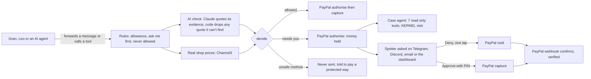
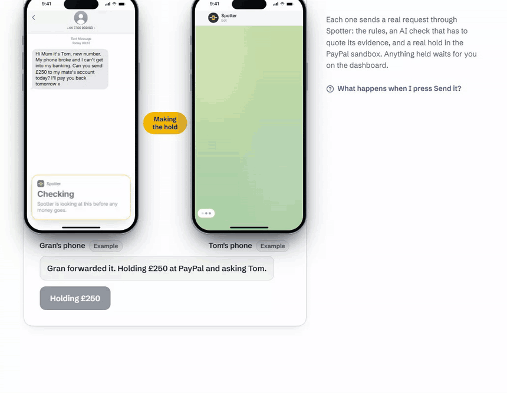

# Spotter

A spotter for every payment: PayPal holds the money until someone you trust says yes.

Gran gets a text from a number she doesn't know. "Hi mum its me, new number. phones dead and I cant get into my banking... Can you send £250 to my mate Jamie's PayPal and I'll pay you back tomorrow. Please hurry mum x". She forwards it to Spotter. PayPal holds her £250, nothing leaves her account, and her son gets a ping asking if it's fine. It isn't. He taps Deny, PayPal lets the money go back, and Gran gets told why.

Your kid and your AI shopping agent work the same way. The agent can ask to pay. It can never say yes.

**Live demo: https://spotter-pay.vercel.app** (no sign up, no PayPal account, everything on the PayPal sandbox with fake money)

[](https://github.com/A1VARA5/spotter/actions/workflows/ci.yml)

[](LICENSE)
[](https://spotter-pay.vercel.app)


<sub>The real live app. The £250 "Hi Mum" hold is a real PayPal sandbox authorisation. Deny voids it at PayPal and the card says so.</sub>

## Contents

- [Try it in 5 minutes](#try-it-in-5-minutes)
- [Technology: how it's built](#technology-how-its-built)
- [Design: calm on a phone](#design-calm-on-a-phone)
- [Impact: who it helps](#impact-who-it-helps)
- [The idea: ask the person being impersonated](#the-idea-ask-the-person-being-impersonated)
- [Presentation](#presentation)
- [PayPal, in depth](#paypal-in-depth)
- [AG Studio and AG Grid](#ag-studio-and-ag-grid)
- [Channel3](#channel3)
- [KERNEL](#kernel)
- [Thinking outside the box](#thinking-outside-the-box)
- [Security and what happens when things fail](#security-and-what-happens-when-things-fail)
- [Honest limits](#honest-limits)
- [Run it locally](#run-it-locally)
- [Where to look in the code](#where-to-look-in-the-code)
- [Credits](#credits)

## Try it in 5 minutes

Open https://spotter-pay.vercel.app and press **Try it on fake money**. You get your own private demo family (Sam the spotter, Gran, Leo and a shopping agent), deleted after 48 hours. The PIN is `2468`.

| Step | What you'll see | Which engine shows it |
| --- | --- | --- |
| 1. The dashboard opens on Gran's "Hi Mum" £250 | A real sandbox hold. The check and case file on it were written earlier and the card says "Example, checked earlier". Deny voids it at PayPal, Approve asks for the PIN and captures it | PayPal Orders v2 and Payments v2 |
| 2. **Try a payment**, booby trapped shop | Stopped. A throwaway cloud browser opens the shop and shows what a person sees next to the hidden line an AI agent reads, plus the tools the page offers to agents | KERNEL, Claude |
| 3. **Try a payment**, "Hi Mum" text | Held. The card asks you "Was it you?", because the text claims to be from you. The side by side example lets you answer as Tom, and his "Not me" releases the money straight away | Claude, PayPal void |
| 4. **Try a payment**, £1.99 parcel text | Held. The link is opened as a desktop and as a UK phone at the same moment. Only the phone gets the card form, and Spotter shows where the card details would go | KERNEL two faces and telemetry |
| 5. **Try a payment**, £4.99 skillet | Held. The shop's picture sits next to the same pan at real shops | KERNEL screenshot, Channel3 image search |
| 6. `/agent-lab`, Hijack the agent | A scripted naive test agent uses PayPal Agent Toolkit tools through Spotter, reads a hidden line, calls `create_refund`, gets frozen, and PayPal voids its hold. About 10 to 12 seconds end to end in my runs | PayPal Agent Toolkit, PayPal webhooks |
| 7. **Watchtower**, then **Gran's view** | An AG Studio board of the month, and the same board for Gran in big type, in English or Polish | AG Studio, Claude |
| 8. **Activity** | An AG Grid table of every payment. Click a row and the case file opens in a drawer | AG Grid |
| 9. **How it checked** (`/checks`) | Each engine's work on your own payments, and all 47 Agent Toolkit tools with what Spotter does to each one | All of them |

The four Try buttons each run one live Claude check and make one real sandbox hold. They come out the same in any order. If the allowance runs low after lots of sends, **Start fresh** on the Try page clears it.


<sub>The agent lab is labelled what it is: a scripted naive test agent. When I pointed real Claude at the same page it refused the bait twice, which is good for Claude and annoying for my demo. Spotter doesn't rely on the model being careful.</sub>

### Testing an AI agent of your own

Open the shopping agent's page (People, Shopping agent). In the connect panel pick **PayPal's Agent Toolkit**, press **Set this agent's allowance in dollars** (the toolkit only makes USD orders), then **Make a key**. The panel gives a one line `claude mcp add` command for Claude Code and an `npx mcp-remote` config for Claude Desktop. Ask the agent to order something with PayPal: its `create_order` becomes a Spotter payment, and anything over the ask me amount waits on your dashboard.

### Sandbox notes

- The demo family needs nothing from you. Every payment is a real PayPal sandbox order with fake money.
- **Log in with PayPal** uses the sandbox, so your real PayPal login won't work there. To try it, make a sandbox personal account at developer.paypal.com (Testing tools, Sandbox accounts).
- What's an example: the hold your demo family starts with has a check and case file written earlier, the price watch it starts with is labelled Example, and Watchtower's starting month is a sample labelled Sample. Everything you send yourself is live.

## Technology: how it's built

Next.js 16 (App Router) and TypeScript in strict mode, Postgres on Neon (PGlite locally, so there's nothing to set up), deployed on Vercel. 1,609 tests in 129 files, all passing in CI.

Every payment takes the same path:



The bits I'm proudest of:

- No AI and no agent can move money. There is no approve tool on either MCP server, and approving a held payment needs the spotter's PIN. The only agent tool that ever captures is a selling agent's `pay_order` on its own sale, after the buyer approved it at PayPal.
- The AI check (`claude-opus-5-5`, 20 second timeout, one retry) reads every message as untrusted text and has to quote the exact words that worried it. Code throws away any warning it can't find in the message, and hidden text (invisible Unicode tags, fake delimiters, fake `<email>` wrappers) is decoded and flagged. If the check can't run, `decide()` fails closed: "The AI check didn't run, so this needs your yes."
- Every status change is one conditional update in Postgres, so Approve and Deny racing each other can't capture twice, and a capture cut off halfway is settled later by asking PayPal for the real state (`reconcileStuck`, also a daily cron).
- Every hold, capture, void, reauthorize and refund carries a `PayPal-Request-Id`: `create-<id>`, `capture-<id>-<auth>`, `void-<id>-<auth>`, `reauth-<id>-<from>`, `refund-<id>`.
- A case agent (Claude with 7 read only tools, 5 turns and 6 tool calls at most, 45 second hard cap) looks into every held payment, usually before the spotter has opened the alert. Every finding has to name the tool call it came from, or code drops it.

The most annoying bug of the build: a semicolon inside a SQL comment in `schema.ts`. PGlite on my laptop didn't care. Neon splits DDL on `;`, so production broke and only production. `src/db/schema.test.ts` now fails the build if a schema comment ever has one again.

The full picture with the money path, the webhook path and every service is in [docs/architecture.md](docs/architecture.md).

## Design: calm on a phone

The person deciding is usually somebody's son or daughter on a phone, on the bus, with Gran waiting. So the held card leads with one sentence, who and how much, and Deny before Approve. Everything else folds behind **See the evidence (N)**.

- Measured on the live site in my last full walkthrough: landing loads in 1.8 s, every Try scenario shows first feedback in 0.55 s, and a whole result lands in 4 to 7 s.
- Checked at 320, 390, 1440, 1920 and 2560 px. App pages use wide screens with a side rail instead of a narrow column next to empty space.
- axe (WCAG 2.2 AA tags) at 390 and 1440 on 13 routes: 0 violations on 12 of them on the live site on 11 October. The 13th, `/agent-lab`, had 14 low contrast nodes on the steps still to come. They now use the normal text colour instead of see through text, and axe found 0 there on my local run. A keyboard walk found visible focus on every stop and no traps, focus moves to the result after Send it, Approve and Deny, and results are announced in live regions.
- Gran's view is its own design: big type, plain words, nothing to approve, and a hand written glossary so "held" can never read like "approved" in Polish.
- Sample shops and people have made up names, and a test keeps real brand names out of the demo data.



## Impact: who it helps

Three groups get the same hold:

- Older relatives who get "Hi Mum" texts, fake parcel fees and Friends and Family requests. UK Finance counted [£576.4m lost in the UK in 2025](https://www.ukfinance.org.uk/system/files/2026-06/UK%20Finance%20Fraud%20Report%202026.pdf) to scams where people were talked into sending the money themselves, up 19% on 2024.
- Kids on game chats, where the cheap game credit scams live. Leo's Discord has a "Check with Spotter" right click.
- AI agents that shop with the PayPal Agent Toolkit, which has no spending limit or approval step of its own.

In the US the FTC reported [$15.9bn lost to fraud in 2025](https://www.ftc.gov/news-events/news/press-releases/2026/03/ftc-testifies-joint-economic-committee-agencys-efforts-combat-fraud), from 3 million reports.

Nobody installs anything new. Gran forwards texts the way she already does, on Telegram or by email. Her son gets the alert where he already is. A small business gets the same Spotter with different words (approver, staff and agents) and two extra checks: a supplier invoice with changed bank details, and a buying agent over budget.

## The idea: ask the person being impersonated

A "Hi Mum" text pretends to be from Tom. Banks ask the payer "was this you?". Spotter asks Tom. His phone buzzes on his own linked Telegram or Discord, one tap of "Not me" voids the hold at PayPal with no PIN needed, and "Yes, it was me" never pays anything by itself.

The rest of the idea is the same move applied to every face of a payment: hold first, then find out. Spotter refuses irreversible payments a stranger is pushing you to make (Friends and Family, gift cards, crypto, bank transfer) and tells the person how to pay with buyer protection instead. It never just warns, because a warning is a popup the scammer talks you past.

## Presentation

You can try every claim in this README on the live site in under 5 minutes, with no account. The three loops above are screen recordings of that site. The Try page's tour names which engine each scenario shows, and `/checks` shows every engine's work on your own payments, so you don't have to take my word for any of it.

Timed on the live site on 11 October 2026, in a cold browser:

| Step | Time |
| --- | --- |
| Try it on fake money to a ready dashboard with a real sandbox hold | 4.75 s |
| The four tour scenarios, Send it to the verdict (booby trapped shop, Hi Mum, parcel, skillet) | 4.7 s, 6.5 s, 7.2 s, 6.1 s. "Checking" shows in under 50 ms |
| Case files written by the case agent | within about 60 s |
| Watchtower, "Did we pay fair prices this month?" | 6.9 s for the answer (2 tool calls) |
| Agent lab, hijacked agent frozen and its hold voided at PayPal | 6.2 s |

The skillet case file folds to about 800 px (it was 3,447 px before the fold), with Deny and Approve on the first screen. axe found 0 violations on 12 of 13 routes at 390 and 1440 px.

The demo video isn't up yet. Its YouTube link goes here with the submission.

## PayPal, in depth

PayPal is the only thing that holds or moves money. Spotter decides when to ask it to.

| API or event | What Spotter uses it for | Code |
| --- | --- | --- |
| `POST /v1/oauth2/token` | Server token, 15 s timeout on every call | `src/paypal/client.ts` |
| `POST /v2/checkout/orders` (`intent: AUTHORIZE`) | Every checked payment becomes a hold. `invoice_id` per payment, `custom_id` from the agent key | `src/paypal/client.ts` |
| `POST /v2/payments/authorizations/{id}/capture` | Approve with the PIN, or an allowed payment | `src/core/lifecycle.ts` |
| `POST /v2/payments/authorizations/{id}/void` | Deny, "Not me", a tripwire, a canary key | `src/core/lifecycle.ts` |
| `POST /v2/payments/authorizations/{id}/reauthorize` | "Ask again tomorrow": renews a hold once, day 4 to 29 | `src/core/sleep.ts` |
| `GET /v2/payments/authorizations/{id}` | Reconcile stuck rows, check a refused capture, the agent lab | `src/core/lifecycle.ts` |
| `POST /v2/checkout/orders` (`intent: CAPTURE`) | A selling agent's example sale | `src/paypal/client.ts` |
| `POST /v1/notifications/verify-webhook-signature` | Every webhook, on the raw bytes | `src/paypal/webhook.ts` |
| Log in with PayPal (OpenID Connect, `userinfo`) | The spotter's account, keyed on the PayPal user id | `src/paypal/identity.ts` |
| `PAYMENT.AUTHORIZATION.CREATED` | Records when PayPal will let the hold go | `src/paypal/webhook.ts` |
| `PAYMENT.AUTHORIZATION.VOIDED` | Confirms a deny on the card ("PayPal confirmed") | |
| `PAYMENT.CAPTURE.COMPLETED`, `.PENDING` | Confirms a capture | |
| `PAYMENT.CAPTURE.DENIED`, `.DECLINED` | Marks the recorded capture failed, final even if events arrive out of order | |
| `PAYMENT.CAPTURE.REFUNDED` | Confirms a refund Spotter approved | |
| `CHECKOUT.ORDER.APPROVED` | Recorded | |
| `IDENTITY.AUTHORIZATION-CONSENT.REVOKED` | Warns the spotter that someone disconnected Spotter (scammers coach this). Never touches payments | |

A webhook never captures or voids anything. Events are deduped on their id, the row is deleted if handling fails so the PayPal retry gets processed, and anything that doesn't match Spotter's own record is written on the payment's timeline instead of changing it.

### The PayPal Agent Toolkit, with a spotter in the middle

PayPal ships an official Agent Toolkit (`@paypal/agent-toolkit`, pinned at 1.11.0). If an agent calls `pay_order`, the money goes. So Spotter runs a second MCP server at `/api/toolkit/mcp` that speaks the toolkit's language: same tool names, same arguments, and the descriptions and JSON Schemas PayPal wrote. An agent written for the toolkit points at Spotter instead and doesn't change.

The thing that took me a while to see: the toolkit is built for sellers. Refunds, invoices, tracking and subscriptions act for the account that gets paid. So one table, `src/core/toolkit-coverage.ts`, decides what happens to all 47 tools for each agent job, and a test checks it against the installed package's own list:

| Agent job | Guarded | Passed through | Tripwire (bait) | Hidden | Offered |
| --- | --- | --- | --- | --- | --- |
| Shopping | 3 | 3 | 35 | 6 | 41 |
| Selling | 3 | 7 | 0 | 37 | 10 |

- `create_order` becomes a Spotter payment. Spotter works out the total from the items itself, because the agent's own `itemTotal` could say anything.
- `pay_order` never captures for a shopping agent. It tells the agent what Spotter decided.
- `create_subscription` stays in the APPROVAL_PENDING state at PayPal, with the whole tail shown first ($0.00 now, $39.99 in 7 days, then monthly). The approval link goes to the spotter after their PIN, never to the agent.
- Tripwires: a shopping agent has no honest reason to call `create_refund`. If it does, someone is steering it. Spotter freezes the agent, voids its holds through the normal deny, alerts the spotter, and shows the page line that probably caused it next to "$200.00 would have left your account, $0.00 sent".
- A selling agent's `create_refund` is held for the PIN, only goes back to the original capture, and is checked against what PayPal says the buyer paid. "They paid £50.00. They're asking for £200.00 back. This is how the overpayment scam works." Tracking is refused until PayPal shows a completed capture, so a fake "payment received" email doesn't count.
- A second lock: `src/paypal/toolkit.ts` only runs the methods in `SPOTTER_RUNS`, so a bait or hidden tool can't reach PayPal even through a bug in the server.

### Agent keys

- Each key is `spt_` plus 32 random bytes, shown once, stored as a SHA-256 hash and the last 4 characters.
- The key card shows the agent's job, allowance left, status and its last 5 tool calls, and reads the newest order back from PayPal to compare its `custom_id` (match, mismatch, missing or error). **Switch off now** revokes the key without making a new one.
- The `custom_id` on every agent order is the key's public label plus the payment id (`spt-abcd:<payment>`), so the order record at PayPal says which key asked.
- A canary key is issued with every real key, as `SPOTTER_KEY_BACKUP`. Nothing legitimate ever sends it. If it shows up, the agent leaked its secrets: Spotter freezes the agent, burns every key, voids its held payments at PayPal and alerts the spotter. The caller just gets a calm 401.
- 100 tool calls per key per day and 2,000 across everyone on the MCP routes.

Agent Ready and Store Sync from PayPal are merchant side. Spotter is the buyer side, so it doesn't depend on them, or on the hosted PayPal MCP server.

## AG Studio and AG Grid

**Watchtower** (`/watchtower`) is the family's board, built on AG Studio 3.0.

- 13 custom widgets of mine (money kept, the hold track with cross filtering, watch alerts, money in mid air with the PayPal countdown, replay the month without Spotter, scam radar, case file, fair price, price watches, the AI's receipt, and three for Gran) next to the built in ones.
- Two themes: the family's, where the chart palette is built from the outcomes present (Stopped red through Paid green), and Gran's, with big type. Gran's view also takes the official AG Studio Polish locale through `localeText`, and everything Spotter says to her is translated by hand in `src/watchtower/granLang.ts`.
- My own agent, "spotter", opens the chat. It has read only tools (`open_case_file`, `watch_alerts`, `scam_radar`, `paypal_status`, `real_price`, `fair_prices`, `add_page`) and one that places an empty tile (`place_widget`). It never configures a widget itself: it hands that to the built in AG Studio planning, page, widget and data agents through `delegate_to`. A second agent of mine, "brief", writes the weekly page the same way. The AG Studio lead agent stays in the roster.
- A typed question becomes a widget. Ask "What did Leo spend on games?" (or anything with "show me" or a breakdown in it) and Spotter places an empty tile on an Answers page, then the widget agent builds the chart while the data agent works out the total, side by side. On my local run the tile showed up 1.5 s after Enter and the whole answer took 13.7 s, with the chart and the chat agreeing on £9.98 and the receipt saying "Money actions: 0". Two of the suggested questions always build a chart this way.
- The fair price question treats a price far below real shops as a fake shop sign, never a saving, and never calls a stopped or denied payment paid. The tool hands the assistant that verdict as data, so it can't decide a suspected fake was a bargain.
- Every agent runs on Claude through my own adapter in place of the AG Studio model layer, so the key stays on the server. 60 turns per family and 600 a day.
- The AI's receipt: the assistant reads words scammers wrote, so I don't take its word for what it did. The AG Studio telemetry records each tool call, and the receipt under the board says which tools ran, money actions (always 0, and any tool not on Spotter's list turns that line red) and board changes. One button undoes exactly what the assistant changed, using the Studio history. Image and free text widgets are switched off, so a scammer's payee name can't become a picture or a paragraph on the board.

**Activity** (`/ledger`) is an AG Grid Community table of every payment, with filters, search and a drawer that opens the case file. Escape puts focus back on the cell.

## Channel3

Price tracking first. When a payment is too dear, held or denied, the spotter can start a price watch on the real product (Channel3 tracking and price history). Spotter only offers it where it makes sense, the target is never above what was asked, Channel3 webhooks are signature checked and treated as hints, a daily job polls as well, and Spotter never buys anything. It tells you a real shop has it for less, and you decide.

Then the part that changes a decision. Real shop prices are code made evidence, not model output: the market check joins the flags before `decide()` runs. A shopping agent finds "premium noise cancelling earbuds, was £249" for £24.99 at a brand new shop. Without Channel3 that's a bargain under the allowance. With it, real shops charge around £169 and the payment is held with the listing to open.

Getting one honest price took work. At one point Channel3 priced a plain kettle like a designer one, and I'd seen an Australian shop's converted price land in a UK going rate. Now there's one going rate per card: UK shops only for pounds, one price per shop, the same department, and the card, the reasons list and spot the difference all read it.

- Spot the difference: the KERNEL screenshot of the held shop goes to Channel3 image search, and the card shows the shop's picture next to the genuine product at real shops.
- Photo price check: a photo of a doorstep quote or an ad gets each thing boxed and priced against real shops, new or used, so a lowball offer for something Gran is selling shows up too.
- Priced like a used one: a "brand new" item priced inside the used range is a sign.
- Searches are cached in Postgres and capped per family and per day, so a loop can't burn the credits.

## KERNEL

A held payment with a suspicious link, or an agent payment with a shop page, gets one throwaway KERNEL cloud browser. Hard limits: one page load, 15 seconds, the browser is always deleted, and the code Spotter runs on the page only reads. It never types, clicks or submits, and Chrome's own policy blocks downloads.

- Seen vs read: the same visit compares the text a person can see with all the text an AI agent reads (in an isolated world), and files hidden instructions as prompt injection with the hidden line quoted.
- Tools for agents: it lists the tools the page registers for AI agents (WebMCP), never runs them, and flags descriptions written to steer an agent.
- Two faces: the same link opens at the same moment as a desktop scanner and as Gran's UK phone (a GB mobile proxy when the plan allows it, and the card says so when it doesn't). Scam kits show scanners a harmless page and keep the card form for real phones.
- Where the money goes: KERNEL telemetry shows where a card form would really send what's typed, even when that's a domain that isn't the shop.
- Zero clicks proof: from the same telemetry, the case file shows Spotter made 0 clicks and 0 key presses. A count Spotter can't back with telemetry it confirmed says "not recorded", never 0.
- Look at it safely: the spotter can watch the page themselves without opening it. The server relays a screenshot about once a second and offers two actions, scroll up and scroll down. 90 seconds, 3 a day per family. The KERNEL live view link never leaves the server.

## Thinking outside the box

Before picking features I asked three fresh AI models, with no idea Spotter existed, what they would build for this hackathon. Their lists overlapped a lot: a dispute defender for sellers, an invoice chaser, a group pot or bill splitter, an agent that buys when the price drops, a subscription cleaner, a spending limit dashboard for agents, a merchant copilot on AG Studio. "Authorise first, capture after a check" turned up inside almost every one of them. So I assumed other people's AI gave them the same list, and that a hold on its own isn't the idea.

What none of them suggested: one specific person (Gran), one specific threat (someone pretending to be family), asking the person being pretended to be, catching instructions hidden from people but read by agents, and a view built for the person being protected instead of the person watching. That's where Spotter lives.

## Security and what happens when things fail

The short version is in [SECURITY.md](SECURITY.md) and the full one in [docs/threat-model.md](docs/threat-model.md).

| Threat | What Spotter does |
| --- | --- |
| Prompt injection in a message or a shop page | Untrusted text is cleaned and fenced, every warning must quote it word for word, hidden text becomes a flag, and the model has no tools and can't move money |
| Tool poisoning (a shop's agent tools that steer) | KERNEL lists them without running them and flags the steering lines |
| A hijacked agent | Tripwire tools freeze it and void its holds. A leaked key trips the canary |
| Webhook forgery | The PayPal verify API on the raw bytes, no webhook id means 503, missing headers 401, 256 KB cap. Telegram, Discord, email and Channel3 hooks are each verified their own way, and an unset secret means refuse |
| SSRF through link checks and cloud browser visits | Link checks walk every redirect hop and refuse private, loopback and link local addresses, and the connection itself only uses the checked address. The cloud browser only opens http or https links that are in the payment's own message, and "look at it safely" walks every hop again before it opens. Whether the KERNEL network itself blocks private ranges is still an open question, written down in the threat model |
| Cost abuse | Daily caps on everything that costs money: Try checks, MCP calls, the agent lab, Watchtower turns, Channel3 searches, KERNEL peeks |
| Approve and a timeout or Deny landing together | Every status move is a conditional update from a list of allowed starting states, so only one wins |

When things break:

- The AI is down, slow or out of credit: the payment is held, never waved through. That one is tested by accident too. My Anthropic key ran out of credit in the middle of testing, and Spotter held the payment anyway. Since then a dead key fails over to a second Claude key, and if Claude can't answer at all the scam check runs once on a backup model with the same prompt and the same quote check. The card says so, and anything the backup checks still waits for a yes. If every model is down the card says it straight: "The AI check is down right now, so Spotter held this for you. Nothing is paid."
- PayPal doesn't answer: captures and voids that time out stay in `capturing` or `voiding` and `reconcileStuck` finishes them from the real state at PayPal. A firm refusal makes Spotter ask PayPal before it changes any label, so a live hold is never relabelled as failed.
- The case agent or KERNEL is slow: the 45 second cap ends the case and the payment still waits for a person.

## Honest limits

- Spotter can't read texts or chat apps by itself, and nothing should. People forward what asks them for money. It can't stop someone paying directly in the PayPal app either. For people it's a habit, like ringing a sensible friend. For AI agents it's enforced, because the agent only has Spotter's tools.
- In the sandbox, agent holds use a sandbox test card. Whether PayPal renews a card funded hold on day 4 is unproven (PayPal said "too soon" on day 1, as it should). The app never claims a renewal unless PayPal returned one. A live version would use a vaulted PayPal wallet.
- If PayPal creates an authorisation but the answer never reaches Spotter, the ids aren't saved and that hold ends only when PayPal expires it.
- Discord DM alerts to the spotter work in code but I haven't seen one land yet. Discord only lets an app DM you if you share a server or allow it in your settings.
- The AI check can be wrong. When it can't run or isn't sure, the payment waits for a person.
- The Polish hasn't been checked by a native speaker yet.
- `npm audit` reports high issues in the Agent Toolkit's own dependencies (langchain, mathjs and others). Spotter only reads tool definitions and calls a few methods, so none of the flagged code runs, but they're there.
- Watchtower runs on an AG Studio trial licence that ends on 24 November 2026. After that the board shows the AG watermark.

## Run it locally

You need Node 22, a PayPal sandbox app (client id and secret from developer.paypal.com, Apps and Credentials, Sandbox) and an Anthropic API key.

```bash
git clone https://github.com/A1VARA5/spotter.git
cd spotter
npm ci
cp .env.example .env.local   # add PAYPAL_CLIENT_ID, PAYPAL_CLIENT_SECRET, ANTHROPIC_API_KEY, SESSION_SECRET
npx next dev -p 3417
```

Open http://localhost:3417 and press **Try it on fake money**. Without `DATABASE_URL` it uses PGlite in `.data/`. Channel3, KERNEL, Agentboxd, Telegram and Discord are optional: without their keys those checks and channels switch off. Every variable is explained in [.env.example](.env.example).

```bash
npm run typecheck
npx vitest run     # 1,609 tests in 129 files
npm run build
```

## Where to look in the code

| What | Where |
| --- | --- |
| The payment lifecycle (rules, check, hold, capture, void, reconcile) | `src/core/lifecycle.ts` |
| Rules and the decision | `src/core/rules.ts`, `src/core/decide.ts` |
| The AI check, grounding and hidden text | `src/ai/check.ts`, `src/core/grounding.ts`, `src/ai/sanitize.ts` |
| PayPal REST, Log in with PayPal, webhooks | `src/paypal/client.ts`, `src/paypal/identity.ts`, `src/paypal/webhook.ts` |
| The PayPal Agent Toolkit with a spotter (47 tool table, tripwires, selling, subscriptions) | `src/core/toolkit-coverage.ts`, `src/core/tripwire.ts`, `src/core/selling.ts`, `src/core/subscriptions.ts`, `src/server/toolkit-mcp.ts`, `src/server/toolkit-guard.ts`, `src/paypal/toolkit.ts` |
| Agent keys, rate limits, canary, key card | `src/core/agent-keys.ts`, `src/core/pairing.ts`, `src/ui/AgentKeyCard.tsx` |
| The agent lab | `src/server/agent-lab.ts`, `src/app/agent-lab/` |
| "Was it you?" | `src/core/was-it-you.ts`, `src/server/was-it-you.ts` |
| The case agent and link checks | `src/agents/case.ts`, `src/agents/tools.ts`, `src/agents/links.ts`, `src/ui/CaseFile.tsx` |
| KERNEL (visits, seen vs read, two faces, telemetry, WebMCP, peek) | `src/agents/kernel.ts`, `src/agents/seen.ts`, `src/agents/twofaces.ts`, `src/agents/trail.ts`, `src/agents/webmcp.ts`, `src/server/peek.ts` |
| Channel3 (prices, image search, photo check, tracking) | `src/market/channel3.ts`, `src/core/market.ts`, `src/market/lookalike.ts`, `src/market/photo.ts`, `src/market/webhook.ts` |
| Watchtower (AG Studio widgets, agents, Claude adapter, receipt, Gran) | `src/app/watchtower/`, `src/watchtower/` |
| Activity (AG Grid) | `src/app/ledger/` |
| Telegram, Discord, email | `src/telegram/`, `src/discord/`, `src/email/` |
| Daily caps on paid calls | `src/core/agent-keys.ts`, `src/server/agent-lab.ts`, `src/server/peek.ts`, `src/watchtower/llm.ts` |

More detail: [docs/architecture.md](docs/architecture.md), [docs/threat-model.md](docs/threat-model.md), [docs/agent-toolkit-notes.md](docs/agent-toolkit-notes.md), [docs/paypal-notes.md](docs/paypal-notes.md), [docs/kernel-notes.md](docs/kernel-notes.md), [CHANGELOG.md](CHANGELOG.md).

## Credits

- PayPal REST APIs, Log in with PayPal, webhooks and the Agent Toolkit, all on the sandbox
- Claude (Anthropic) for the scam check, the case agent, reading screenshots and the Watchtower agents
- AG Studio (trial licence) for Watchtower and AG Grid Community for Activity
- Channel3 for real shop prices, image search, photo checks and price tracking
- KERNEL for the throwaway cloud browsers
- Agentboxd for the spotter@homingbox.net inbox
- Neon Postgres and Vercel for hosting
- The email sender checks and webhook verification come from my earlier project, [Red Flag](https://github.com/A1VARA5/redflag), reused and credited here
- Claude Code (Anthropic), used as a coding tool

MIT licence, see [LICENSE](LICENSE). Contributions: [CONTRIBUTING.md](CONTRIBUTING.md). Conduct: [CODE_OF_CONDUCT.md](CODE_OF_CONDUCT.md).
