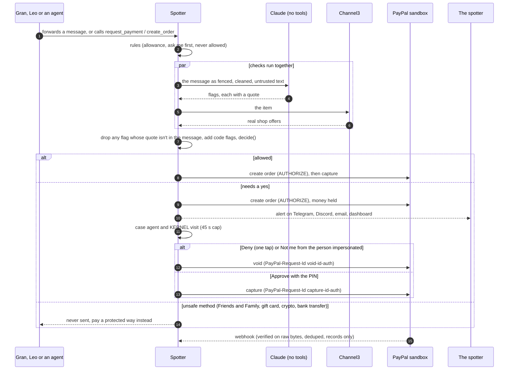
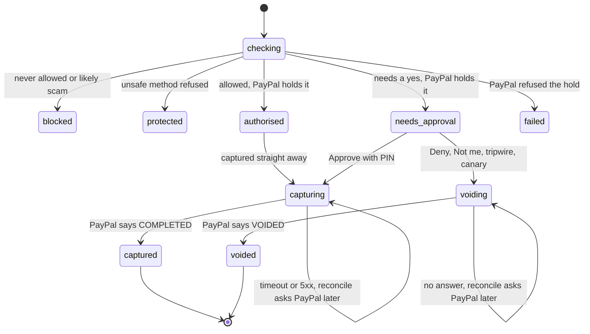
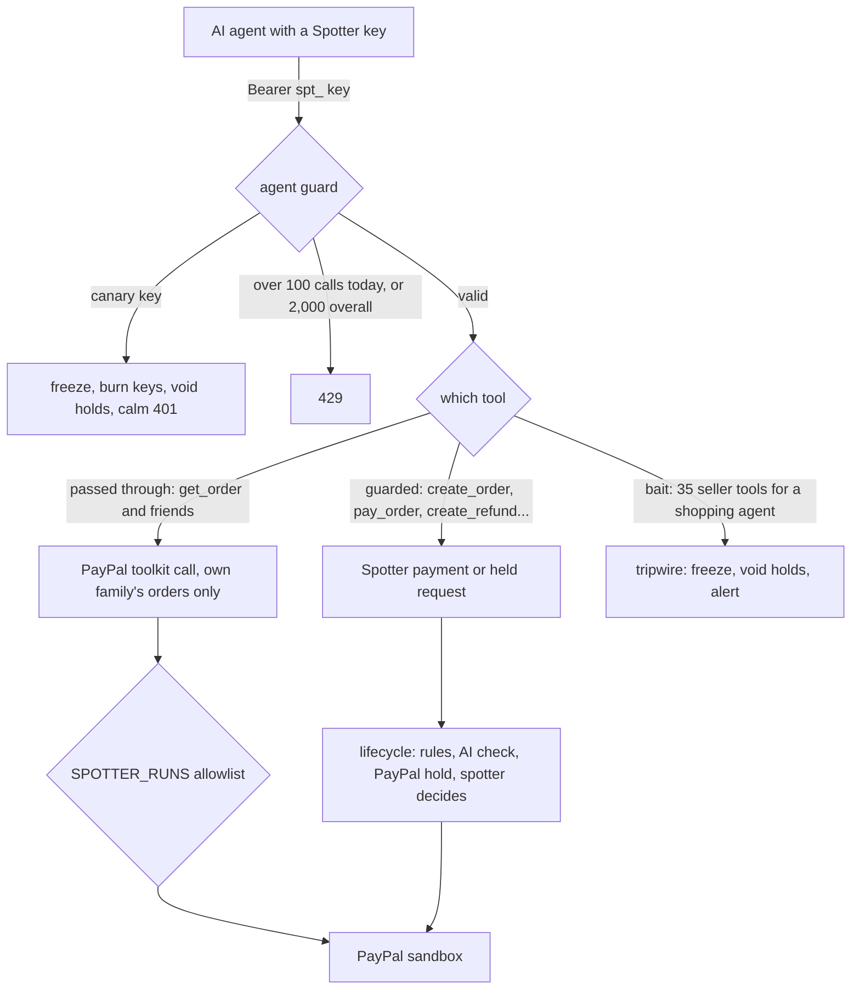

# Architecture

How a payment gets from Gran's forwarded text (or an agent's tool call) to PayPal, and who is allowed to do what on the way. File paths are relative to the repo root.

## The pieces

| Piece | What it is | Where |
| --- | --- | --- |
| Web app and API | Next.js 16 App Router on Vercel, TypeScript strict | `src/app/` |
| Database | Postgres on Neon in production, PGlite in `.data/` locally. Schema runs on start | `src/db/` |
| Lifecycle | Every payment's states and the only code that asks PayPal to hold, capture or void | `src/core/lifecycle.ts` |
| Rules and decision | Allowance, ask me first amount, never allowed categories, then `decide()` | `src/core/rules.ts`, `src/core/decide.ts` |
| AI check | Claude reads the request as untrusted text and must quote its evidence | `src/ai/check.ts`, `src/core/grounding.ts`, `src/ai/sanitize.ts` |
| Market check | Real shop prices from Channel3, turned into code made flags | `src/market/channel3.ts`, `src/core/market.ts` |
| Case agent | Claude with 7 read only tools, runs after a payment is held | `src/agents/case.ts`, `src/agents/tools.ts` |
| Cloud browser | One throwaway KERNEL browser per case | `src/agents/kernel.ts` |
| PayPal | REST client, Log in with PayPal, webhooks, Agent Toolkit | `src/paypal/` |
| Agent servers | `/api/mcp` (Spotter's own tools) and `/api/toolkit/mcp` (the PayPal toolkit tools, guarded) | `src/app/api/mcp/`, `src/server/toolkit-mcp.ts` |
| Channels | Telegram, Discord, email (Agentboxd) for forwarding and alerts | `src/telegram/`, `src/discord/`, `src/email/` |
| Watchtower | AG Studio board with Spotter's widgets and agents, Claude adapter | `src/app/watchtower/`, `src/watchtower/` |
| Daily job | Reconciles stuck payments with PayPal, renews holds the spotter asked to sleep on | `src/app/api/cron/reconcile/`, `vercel.json` |

## The money path

Every arrow into PayPal starts in `src/core/lifecycle.ts`. Nothing the AI says, and nothing an agent sends, reaches PayPal except through `submitPayment` and the spotter's own approve or deny.

## Payment states

Each move is one `update payments ... where id = $1 and status = $2` in Postgres (`move()` in `src/core/lifecycle.ts`). If Approve and Deny land at the same moment, only one of them finds the row in a state it may move from, so money is captured once or voided once, never both. A row that crashed after PayPal made the hold stays in front of the spotter instead of disappearing.

## The webhook path

`/api/paypal/webhook` reads the raw body (256 KB cap), needs all five PayPal transmission headers, and asks the PayPal `verify-webhook-signature` API with those exact bytes. No `PAYPAL_WEBHOOK_ID` means 503, so nothing is trusted by accident. Then `src/paypal/webhook.ts`:

1. Inserts the event id into `paypal_events` (`on conflict do nothing`), so a repeat is dropped.
2. Finds the payment and applies a conditional update from a whitelist of starting states.
3. Writes anything that disagrees with Spotter's own record on the payment's timeline as a mismatch.
4. Deletes the event row if handling throws, so the PayPal retry is processed.

A webhook never captures or voids. It only records what PayPal says happened.

## The agent path

The coverage table in `src/core/toolkit-coverage.ts` drives both the server and the "all 47 tools" view in the app, so the page can't say one thing while the server does another. `src/paypal/toolkit.ts` only runs methods in `SPOTTER_RUNS`, a second lock behind the table.

## Watchtower

AG Studio 3.0 renders the board in the browser. Its model calls go to `/api/watchtower/llm`, which runs Claude on the server (the key never reaches the browser), logs usage per turn, and caps turns at 60 per family and 600 a day. Spotter's own agent and the weekly brief agent read through tools defined in `src/app/watchtower/Studio.tsx` and hand building work to AG's built in agents. The board's data comes from `src/watchtower/data.ts`, and watch alerts are made by code, not the model.

## Services and what happens without them

| Service | Used for | Without its key |
| --- | --- | --- |
| PayPal sandbox | Holds, captures, voids, login, webhooks, toolkit | Required |
| Anthropic | AI check, case agent, screenshot reading, Watchtower | Required. If it fails at runtime, payments are held for a person |
| Channel3 | Prices, image search, photo check, price tracking | Price checks switch off |
| KERNEL | Cloud browser visits, two faces, telemetry, peek | Links are checked without being opened |
| Agentboxd | Email forwarding and alerts | Email channel switches off |
| Telegram, Discord | Forwarding, alerts with one tap Deny, "Was it you?" | Those channels switch off |
| AG Studio licence | Watchtower without a watermark | Works, shows AG's watermark |
