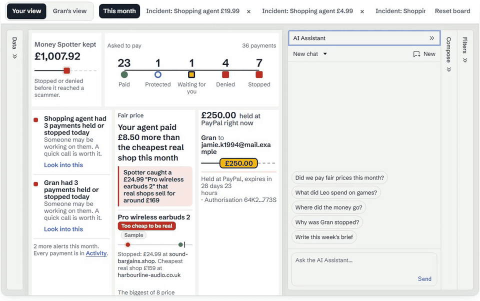

# A custom AG Studio agent that lets the built in agents do the building

On the live site, typing "What did Leo spend on games?" into Watchtower put a chart on the board in about 18 s with 13 tool calls (12 October). My own agent configured none of it. It placed one empty tile, then handed the chart to the Widget agent and the sum to the Data agent that ship with AG Studio 3.0. Here's how, and what broke on the way.



## The roster

[src/watchtower/agents.ts](../../src/watchtower/agents.ts) builds one list: my agent `spotter` as primary, a second agent `brief` that writes a weekly page, and the five built in agents (lead, planning, data, page, widget) with Spotter context added. [Studio.tsx](../../src/app/watchtower/Studio.tsx) pairs each one with `directLlmRunner` and my adapter:

```ts
const inner = createAiHarness(api, ({ builtIn }) => {
  const roster = buildRoster({ builtIn, extra: { caseFile, alerts, radar, paypal, price, fair, addPage, place }, context, demo });
  return {
    agents: roster.agents.map((d) => directLlmRunner({ ...d, adapter: spotterAdapter(undefined, d.id) })),
    primary: roster.primary,
    history,
    observers: [recorder],
  };
});
```

The thing that took me longest to see: the built in lead delegates to a fixed set of ids, so a new agent is only reachable from a lead you write yourself. So `spotter` carries its own `tools.delegateTo(["brief", "data", "planning", "page", "widget"])`. Its other tools only read (`open_case_file`, `watch_alerts`, `scam_radar`, `paypal_status`, `real_price`, `fair_prices`), and two touch the board (`add_page`, `place_widget`).

## place_widget, then two delegations in one turn

`place_widget` puts an empty tile titled for the question at the top of an Answers page and returns `widgetType`, `widgetId` and `pageId`. Only chart and table types from `api.getAiContext().catalogue()` can be placed. On the next turn `spotter` sends both of these side by side:

- `delegate_to` widget, with the ids and a one sentence brief naming the fields and filters
- `delegate_to` data, for the total with the same filters, so the chart and the sentence in chat agree

The same question again brings back the same tile. The empty tile shows up within a couple of seconds, long before the chart is built.

## The receipt comes from telemetry

The assistant reads payee names that scammers wrote, so I don't take its word for what it did. [src/watchtower/receipt.ts](../../src/watchtower/receipt.ts) is an `AgAiTelemetryObserver` that folds each run, delegated sub runs included, into tool names, counts and times. No prompts, arguments or results are kept. Every tool Watchtower can call is listed in `TOOL_ACCESS` as read, chat or board. Anything else counts as a money action, turns the line red and flags the run. The Leo run reads "Money actions: 0".

**Undo what Spotter changed** ([runUndo.ts](../../src/watchtower/runUndo.ts)) notes the Studio history ids when a run starts, and Undo calls `undo(id)` on exactly the entries added since. AI tool changes and `setState` both land in history, which I checked in the running app. After a remount the ids mean nothing, so Undo falls back to the board saved at run start, only while the board is still as the run left it.

`aiToolDisplay` cards are built from counts and fixed labels only, so a payee name can never become a card title.

## A model per agent

The browser only sends the agent id, and `modelFor` in [llm.ts](../../src/watchtower/llm.ts) picks: `spotter` and Gran's agent on `claude-sonnet-5-5`, the builders on `claude-opus-5-5`. The key stays on the server, with 60 turns per family and 600 a day taken in one SQL insert. Haiku was faster again, but once it told a family they paid fair prices when they had overpaid, so it's out.

## The chart polish hook

AG Studio has no colours per value, and a saved widget format can't put a currency on an axis. [chartPolish.ts](../../src/app/watchtower/chartPolish.ts) wraps `AgCharts.create` and `chart.update` once per page load: neutral colours on answer tiles, pounds on money axes, slim lone bars. If polishing throws, Studio's own chart is drawn. `ag-charts-enterprise` is pinned at 14.2.0 so both sides import the same `AgCharts`.

## When an answer doesn't finish

"Building your chart" only shows while a run is live in this tab. An empty newest tile with nothing running (tab closed, reload, Stop, a remount) says "This answer didn't finish" with **Ask again**, which reuses the same tile. A tile the Widget agent never set up comes off when the run ends, with a note in chat.

## The remount

AG Studio 3.0 reads `data` once, and new rows don't redraw the board. Until the real time update AG announced for about 28 October, Watchtower remounts `<AgStudio>` with a new key, carrying the board as it is. It waits while a run is going or a message is half typed.

## What went wrong and how I fixed it

| What happened | What I changed | Where |
| --- | --- | --- |
| My own test round typed the Leo question and got a paragraph in chat, "Board changes: 0", after 16.4 s | `place_widget`, then widget and data delegations in the same turn | [`6fee7e7`](https://github.com/A1VARA5/spotter/commit/6fee7e7) |
| "Did we pay fair prices?" called a £6.99 skillet from a suspected fake shop "a good price" | `fair_prices` hands over `too_cheap_to_be_real` as data, and the role says it's never a saving | [`6fee7e7`](https://github.com/A1VARA5/spotter/commit/6fee7e7) |
| The fair price answer took about 20.7 s (5 Opus turns and a hop to the Data agent) | One `fair_prices` tool and Sonnet for `spotter`: about 6 s live with 2 tool calls | [`ddddcdb`](https://github.com/A1VARA5/spotter/commit/ddddcdb) |
| New payments never appeared on an open board | Remount with a new key, waiting while anyone is busy | [`4b3bc3a`](https://github.com/A1VARA5/spotter/commit/4b3bc3a) |
| The receipt could say 0 board changes when the snapshot was missing | It says "couldn't be checked", and an unknown tool seen only at the end still flags the run | [`fe945da`](https://github.com/A1VARA5/spotter/commit/fe945da) |
| The assistant answered from the sample month without saying so | Its role makes it say "From the sample month" | [`5d4e790`](https://github.com/A1VARA5/spotter/commit/5d4e790) |
| A chart with one shop drew its bar as a block across the whole tile | Slim bars when there are fewer than 8 | [`cf31082`](https://github.com/A1VARA5/spotter/commit/cf31082) |
| Outcome colours followed the order rows arrived in, not the outcome | Rows sorted worst first, the palette built from the outcomes present, then the polish hook | [`7f9fbea`](https://github.com/A1VARA5/spotter/commit/7f9fbea), [`d12d488`](https://github.com/A1VARA5/spotter/commit/d12d488) |

## What it costs

- AG Studio runs on a trial licence here, and AG Grid Community is free (MIT).
- Claude is the real cost. The route logs token counts for every turn, and the Leo question on a fresh demo family on 12 October was 6 turns on `claude-opus-5-5` and 4 on `claude-sonnet-5-5`: about $0.37 at list prices, most of it writing the prompt cache the first time. Another question within 5 minutes reads that cache at a tenth of the price.
- That's about 4 cents a turn, so the 600 turns a day cap keeps a bad day under about $22.

## If it doesn't work

| What you see | What to check |
| --- | --- |
| A watermark on the board | `NEXT_PUBLIC_AG_STUDIO_LICENSE_KEY` isn't set. On localhost Studio works without it. |
| "The assistant couldn't answer just now" | The model call failed. The server log line starts `[spotter] watchtower turn failed`, with the Anthropic error after it. A missing or out of credit `ANTHROPIC_API_KEY` ends up here too. |
| "Watchtower's assistant has done all it can for your family today" | The 60 turns per family cap. `WATCHTOWER_TURNS_PER_FAMILY` and `WATCHTOWER_TURNS_PER_DAY` change the caps on your own copy. |
| "This answer didn't finish" next to an empty tile | The run stopped before the Widget agent set the tile up: a reload, Stop, a closed tab or a remount. **Ask again** reuses the same tile. |
| A new payment isn't on the board | The remount waits while a run is going or a message is half typed. Finish or clear the message. |

## Run it

```bash
npm ci
# .env.local: NEXT_PUBLIC_AG_STUDIO_LICENSE_KEY, ANTHROPIC_API_KEY
npx next dev -p 3417
npx vitest run src/watchtower src/app/watchtower   # 28 files, 456 tests on 12 Oct
```

Off localhost, AG Studio shows its watermark without a licence key. Mine is a trial that ends on 24 November 2026.

## Try it yourself

1. Open https://spotter-pay.vercel.app and press **Try it on fake money**.
2. Open **Watchtower** and type "What did Leo spend on games?". Watch the empty tile appear, then fill.
3. Read the receipt under the board, then press **Undo what Spotter changed**.
4. Ask "Did we pay fair prices this month?" and compare the answer with the Fair price tile.
