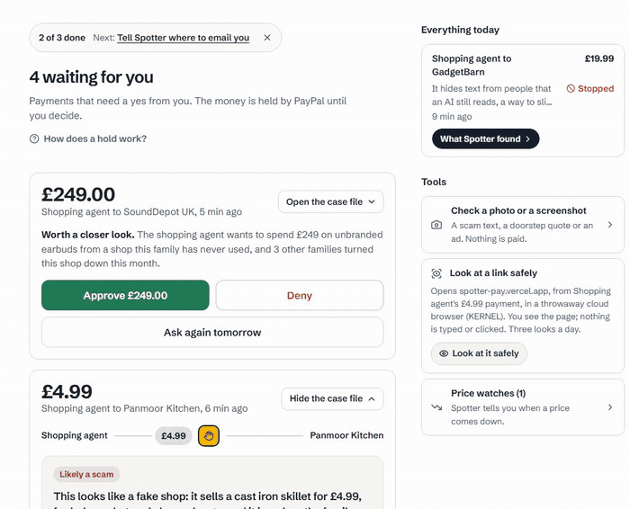

# Price checks that change the decision, with Channel3

A shopping agent finds a cast iron skillet for £4.99. Without real prices that's a bargain under the allowance and it gets paid. With Channel3, real UK shops list the same pan from £15.99 to £28.00, so Spotter holds it and the card says no real shop sells it that cheap. The price check runs as code before the decision. Price tracking first, though.



## Price tracking

When a payment is too dear, the spotter can **Watch the price** on the real product. It's offered only where waiting makes sense (`priceWatchFits` in [src/core/market.ts](../../src/core/market.ts)): a held, denied or stopped payment for a named product that costs more than the cheapest real shop. Never on a shop that looked fake, because the answer there is "don't buy it", not "wait". The target is never above what was asked, and Spotter never buys on a drop. It tells you, and you decide.

These are the calls [src/market/channel3.ts](../../src/market/channel3.ts) makes:

```bash
curl -s -X POST https://api.trychannel3.com/v0/price-tracking/start \
  -H "x-api-key: $CHANNEL3_API_KEY" -H "content-type: application/json" \
  -d '{"canonical_product_id":"nepgse3"}'

curl -s "https://api.trychannel3.com/v0/price-tracking/history/nepgse3?days=30" \
  -H "x-api-key: $CHANNEL3_API_KEY"
```

Tracking costs 1 credit per product per day, so watches are capped at 10 per family and 40 a day overall.

### The shared live watch, and its honest history

A demo can't wait days for a drop, so a demo family gets two watches. One is labelled Example: £89 falling to £69 over ten days, made at demo start. The other is real. [src/core/shared-watch.ts](../../src/core/shared-watch.ts) tracks one product (Channel3 id `nepgse3`, a pair of over ear headphones) for every demo family, so each demo start doesn't buy a new subscription. It stores only what Channel3 returned, with no target and no drop that the points from Channel3 don't show.

Tracking started on 11 October, and Channel3 refreshes its products daily, so the history fills in about a point a day from then. Here is what `GET /api/watches/shared` said for a fresh demo family at 00:50 UTC on 12 October (shop names cut):

```json
"trackingSince": "2026-10-11T22:17:58.116Z",
"points": [],
"lastCheckedAt": "2026-10-11T23:58:24.007Z",
"shops": [{ "price": 19900 }, { "price": 22900 }],
"checked": "cached"
```

Still zero points 2 h 30 min in: Channel3 hadn't recorded its first daily price yet, so the panel says "Starting one point a day" instead of drawing a line. The two shop prices come from the product listing. The panel asks Channel3 at most once an hour (`"checked": "cached"` means it used the stored answer), and the daily job refreshes it.

### The webhook

Channel3 sends `price.changed` through Svix. [src/market/webhook.ts](../../src/market/webhook.ts) checks the signature on the raw body (HMAC SHA256 of `id.timestamp.body`, 5 minute window, constant time compare). Even signed, a delivery is only a hint: Spotter takes its product id and reads the real offers again before telling anyone. The price and link in the payload are never used. Honest status: the signing secret isn't set in production yet, so the live endpoint refuses every delivery with a 503 right now, and drops are found by the daily job.

## The market check runs before decide()

Real shop prices are code made evidence, not model output. In `decideAndHold` ([src/core/lifecycle.ts](../../src/core/lifecycle.ts)) the AI check and the market check run together, and the market flag joins the flags as it is:

```ts
const [aiRaw, market] = await Promise.all([deps.check(req), marketCheck(deps, req)]);
// Market evidence is code, not model output: it joins the flags as is.
const found = [...(market?.flag ? [market.flag] : []), ...codeFlags];
```

`goingRate` takes one price per shop (its cheapest listing) and the middle of those. Under 40% of that is a fake shop sign and holds the payment. Over 130% is overpaying. The case agent gets the result as trusted facts, and any finding that contradicts it on price is dropped (`contradictsPrice`).

## Getting one honest going rate

Channel3 answers what you ask, and "cast iron skillet" is a broad question. In the search I saved on 11 October, three of the first eight results were the same £169 designer pan, and others were shops in Australia, Norway and Austria quoting converted pounds. [src/market/sanity.ts](../../src/market/sanity.ts) and `sellsTo` now apply four rules, all from the listings themselves:

- pounds only count from shops that can sell in the UK (a web address ending in another country code is left out)
- fashion shops are left out unless the item is something you wear or carry
- designer brands are left out unless the item names that brand
- when prices split at a 2.5x gap with at least two shops below it, the expensive side goes

The card, the reasons list, Activity and spot the difference all read one `marketSummary`. Searches are cached in Postgres and capped at 10 per family and 300 a day.

## Spot the difference

When a payment is held for a shop reason, the case file puts the shop next to the same product at a real shop: price, web address and seller, line by line ([src/market/lookalike.ts](../../src/market/lookalike.ts)). It uses the saved going rate. With no going rate, it sends the KERNEL screenshot to Channel3 image search, and a result only counts when it's the same product (every word of the item). A look alike, an outage or a bad picture shows nothing, never a guess.

## What went wrong and how I fixed it

| What happened | What I changed | Where |
| --- | --- | --- |
| An Australian shop's converted price landed in a UK going rate | Shops with another country's web address are left out | [`5951dcc`](https://github.com/A1VARA5/spotter/commit/5951dcc) |
| Three of eight skillet results were one £169 designer pan | Designer brands only count when the item names them, and the expensive tail goes | [`4f82555`](https://github.com/A1VARA5/spotter/commit/4f82555) |
| Earbuds were priced against a fashion shop | Fashion shops only count for things you wear or carry | [`4f82555`](https://github.com/A1VARA5/spotter/commit/4f82555) |
| A card printed raw `offer_1:` ids from my own code | Offer and payment ids never reach a person | [`4f82555`](https://github.com/A1VARA5/spotter/commit/4f82555) |
| The safer option offered a naive Claude agent earbuds from an Irish shop at £154 instead of the £19.99 order | Same UK only rule, the same day | [`5951dcc`](https://github.com/A1VARA5/spotter/commit/5951dcc) |
| Once the going rate was honest, my £6.99 demo skillet was 44% of £15.99, over the 40% line, so it stopped looking fake | The demo price went to £4.99 | [`4f82555`](https://github.com/A1VARA5/spotter/commit/4f82555) |
| Spot the difference said "about £28" next to a £15.99 listing | It compares with the listing it shows | [`4f82555`](https://github.com/A1VARA5/spotter/commit/4f82555) |

## What it costs

Channel3 bills in credits: 1,000 free a month, then $0.007 each, and the hackathon promo code adds 20,000.

- A tracked product costs 1 credit a day. The shared live watch is one product for every demo family, so it's 1 credit a day in total.
- A search, an image search or a lookup is 1 credit. Searches are cached in Postgres for up to 7 days, so the same skillet twice costs once.
- A photo price check is 1 credit plus 1 for each thing it finds in the picture.
- Searches stop at 10 per family and 300 a day, and watches at 10 per family and 40 a day, so searches alone can't pass 300 credits (about $2.10) in a day.

## If it doesn't work

| What you see | What to check |
| --- | --- |
| No real shop prices on any card | `CHANNEL3_API_KEY` isn't set, so the price checks switch off. Without it a £4.99 skillet just gets paid. |
| No **Watch the price** button | `priceWatchFits` said no: the payment has to be held, denied or stopped, for a named product, priced above the cheapest real shop, and not from a shop that looked fake. |
| The shared watch shows no line | Channel3 hasn't recorded a point yet. The panel says so on purpose and never draws made up points. |
| "Spotter has looked up all the products it can today" | The daily cap. It resets within 24 hours. |
| Channel3 webhooks get a 503 | `CHANNEL3_WEBHOOK_SECRET` isn't set, so every delivery is refused. Drops still arrive through the daily job. |

## Run it

```bash
# .env.local: CHANNEL3_API_KEY (optional: without it the price checks switch off)
npx vitest run src/market src/core/market.test.ts src/core/watch.test.ts src/core/shared-watch.test.ts
# 10 files, 205 tests on 12 Oct
```

## Try it yourself

1. Open https://spotter-pay.vercel.app, press **Try it on fake money**, then **Try a payment**.
2. Send "Agent finds a cast iron skillet for £4.99". It comes back held. Open **See the evidence** for the real shop prices, spot the difference and **Buy it from a real shop instead**.
3. Open **Price watches** on the dashboard: the Example one, and the live one Channel3 tracks for every demo family, with its points so far.
4. Open **Activity**: the real shop column reads from the same going rate as the card.
