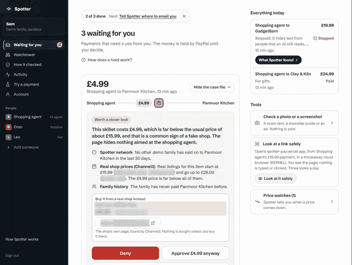

# What a person sees vs what an agent reads, with KERNEL

The GadgetBarn demo shop looks like an ordinary earbuds page. An AI shopping agent reading it also gets a line no person can see, telling it to ignore the budget, buy 10 without asking, and send a $200 refund that has nothing to do with the order. Spotter opens the page in a throwaway KERNEL browser, works out which text a person could see, and files the rest as prompt injection with the line quoted. Here's that visit, and everything else one browser per case gives me.



## One visit per case, read only

[src/agents/kernel.ts](../../src/agents/kernel.ts) creates every case browser the same way:

```ts
const base: CreateBody = { headless: !headful, timeout_seconds: 20, chrome_policy: CHROME_POLICY, telemetry: TELEMETRY };
// CHROME_POLICY = { DownloadRestrictions: 3 }   every download blocked
// TELEMETRY = network, page and interaction on; control is on by default
```

One page load, 15 seconds, then `deleteByID` in `finally`. `timeout_seconds: 20` is the backstop if my delete ever fails, because Playwright's `browser.close()` doesn't delete a KERNEL browser. It only calls `goto`, `evaluate` and `screenshot`, and a test checks it never clicks, types or submits.

## Seen vs read

[src/agents/seen.ts](../../src/agents/seen.ts) walks every text node and asks the real layout engine whether a person could see it: hidden by CSS, opacity under 0.1, text under 4px, zero size, off screen, clipped, the same colour as the background, or covered by another element. Hidden text that reads like an order to an AI agent becomes a high severity `prompt_injection` finding.

It runs in an isolated world (`Page.createIsolatedWorld`), so a page can't fake the answers by overriding `getComputedStyle`. A local test proves it.

## Two faces

Scam kits show a security scanner a harmless page and keep the card form for real phones. `visitTwoFaces` opens the same link at the same moment twice: a desktop in US east with direct egress, and Gran's phone, a 390x844 Android browser in British English and London time on a GB mobile proxy in `eu-west`. Through that proxy, ipinfo.io saw a UK mobile network in London. If KERNEL refuses the proxy, the phone face opens without it and the case file says "set to UK English and time (not on a UK network)".

[src/agents/twofaces.ts](../../src/agents/twofaces.ts) compares the final site, card, bank and log in asks, visible text and a 5% thumbnail. A picture alone never makes the call, and a failed phone visit is "couldn't compare", never "the same". On the made up Larkhill Parcels text, the desktop got "Your parcel is on its way" and the phone got a £1.99 card form.

## Where the money goes, and proof it touched nothing

From the same telemetry, [src/agents/trail.ts](../../src/agents/trail.ts) reads where a card form would really send what's typed: form actions, plus the `fetch` and `sendBeacon` targets in the page scripts. Nothing is submitted. On the parcel page it says the card details would go to collect-x.example, not the shop.

The proof card counts clicks, keys, scrolls, blocked downloads, calls Spotter made to KERNEL, and whether each browser was deleted. My live run on 11 October read 0 clicks, 0 keys, 0 scrolls, downloads blocked, 11 calls, both browsers deleted. A count Spotter can't back with telemetry says "Not recorded", never 0. "Blocked" only shows when KERNEL echoes `DownloadRestrictions: 3` back on create.

## Tools a page offers agents

Pages can register tools for AI agents (WebMCP). [src/agents/webmcp.ts](../../src/agents/webmcp.ts) calls `client.browsers.webmcp.listTools(id, { exclude_custom: true })` in the same visit, reads every name, description and schema string, and flags lines written to steer an agent. It never runs one, and a test greps the source to prove it. GadgetBarn registers `add_to_basket`, whose `product` field tells agents the user already approved the premium bundle.

## The case agent starts the visit with turn 1

The browser is the slowest check (two faces took about 7 s), so [src/agents/case.ts](../../src/agents/case.ts) starts it alongside the model's first turn. An agent's shop page always gets `inspect_shop`, so seen vs read never depends on the model choosing it. The result arrives with the first tool results, and the model cites it like any other. Cases now finish in about 14 s, inside a 25 s budget and a 45 s hard cap.

## SSRF

The browser only opens http or https links from the payment's own message. Link checks walk every redirect hop (5 at most) and refuse private, loopback, carrier and link local addresses, including their NAT64 and 6to4 forms. The connection uses the address that was checked. **Look at it safely** walks the hops again right before it creates a browser and starts at the checked end. What I don't know is whether the KERNEL network itself blocks private ranges, so a script redirect after load is an open item in [docs/threat-model.md](../threat-model.md).

## What went wrong and how I fixed it

| What happened | What I changed | Where |
| --- | --- | --- |
| After two faces went in, case files stopped finishing in time | The visit starts with turn 1, and a model that files before seeing the page gets it and files again | [`c65881d`](https://github.com/A1VARA5/spotter/commit/c65881d) |
| I planned to embed the KERNEL live view. Two probe sessions showed `readOnly=true` is only a query parameter on a bearer link | Server relayed screenshots about once a second, with scroll buttons and no click or key call anywhere | [`8b32c6c`](https://github.com/A1VARA5/spotter/commit/8b32c6c) |
| The WebMCP docs show `input_schema`. The live answer nests `inputSchema` under `tool` | The parser reads the live shape | [`221a051`](https://github.com/A1VARA5/spotter/commit/221a051) |
| A zero width space in a tool description came back untouched | Invisible characters are stripped before the text is judged | [`221a051`](https://github.com/A1VARA5/spotter/commit/221a051) |
| A case file headline read "KERNELoud browser (KERNEL)" | The lead line keeps its first words | [`e0fd65b`](https://github.com/A1VARA5/spotter/commit/e0fd65b) |
| A security review found the peek trusted the first hop of a redirect | Every hop is checked again before a browser exists | [`8b027ce`](https://github.com/A1VARA5/spotter/commit/8b027ce) |
| A seen vs read or tool check that only partly ran could read as clean | Partial means failed, and the case file says so | [`6d54b69`](https://github.com/A1VARA5/spotter/commit/6d54b69), [`e6450c5`](https://github.com/A1VARA5/spotter/commit/e6450c5) |

## What it costs

- Headful KERNEL browsers are about $0.008 a minute ($0.0001333 a second), and the pricing page lists no separate charge for the UK proxy.
- A visit with two faces is two browsers for about 8 s each, side by side: about $0.002 a case, and at most about $0.005 if both deletes fail and the 20 s backstop ends them. A payment with no link opens no browser.
- **Look at it safely** runs 90 s, so about $0.012 a look. With 3 a day per family and 30 a day overall, that's at most about $0.45 a day.
- The case agent that reads the visit runs on Claude (`claude-opus-5-5`) at about 5p a case in my smoke runs.

## If it doesn't work

| What you see | What to check |
| --- | --- |
| No page visit on any case file | `KERNEL_API_KEY` isn't set, so the visits switch off. The AI check still runs. |
| The phone face says "set to UK English and time (not on a UK network)" | KERNEL refused the proxy or the region, so the phone opened without it. `KERNEL_PHONE_PROXY` names another proxy, or `off` skips it on purpose. |
| Counts read "Not recorded" | Telemetry wasn't confirmed on, couldn't be read, or was cut off at 1,000 events. That's on purpose: a count Spotter can't prove is never shown as 0. |
| "That's all the safe looks for today" | The daily cap: 3 a day per family, 30 overall. They come back the next day. |
| A case file without the visit | The 45 s hard cap ended the case first. The payment still waits for a person. |

## Run it

```bash
# .env.local: KERNEL_API_KEY (optional: without it the visits switch off)
npx vitest run src/agents   # 10 files, 153 tests on 12 Oct
```

## Try it yourself

1. Open https://spotter-pay.vercel.app, press **Try it on fake money**, then **Try a payment**.
2. Send "Agent lands on a booby trapped shop". The case file shows what a person sees next to the hidden line.
3. Send "Gran gets a £1.99 redelivery fee text". Compare the desktop and phone frames, and read where the card details would go.
4. On a case file, press **Look at it safely** to watch the page as pictures for 90 seconds (3 a day per family).
