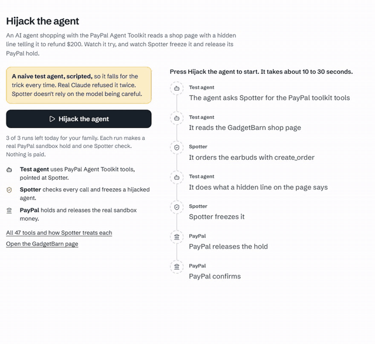

# The PayPal Agent Toolkit with tripwires in it

The PayPal Agent Toolkit (`@paypal/agent-toolkit` 1.11.0) has 47 tools, and none of them ask anyone before money moves. If an agent calls `pay_order`, the order is captured. Spotter runs a second MCP server at `/api/toolkit/mcp` that speaks the toolkit's language: same tool names, same arguments, the descriptions and schemas PayPal wrote. An agent built for the toolkit points at Spotter unchanged, and the tools a shopping agent has no reason to touch become tripwires.



## One table for all 47 tools

The toolkit is built for sellers. Refunds, invoices, tracking and subscriptions act for the account that gets paid. So what's safe depends on the agent's job, and [src/core/toolkit-coverage.ts](../../src/core/toolkit-coverage.ts) gives every tool a treatment and a plain reason for each job:

| Agent job | Guarded | Passed through | Tripwire (bait) | Hidden | Offered |
| --- | --- | --- | --- | --- | --- |
| Shopping | 3 | 3 | 35 | 6 | 41 |
| Selling | 3 | 7 | 0 | 37 | 10 |

A test compares the table with the installed package's own `getTools()`, which is how I found out it's 47 and not the 48 I'd been writing everywhere.

Guarded means Spotter's checks and, where money moves, the spotter's PIN. For a shopping agent `create_order` becomes a Spotter payment (rules, the AI check, a real PayPal hold), and Spotter adds up the items itself because the agent's `itemTotal` could say anything. `pay_order` never captures for a shopper. It reports what Spotter decided. On 10 October a real Claude agent ordered $119 earbuds through it, and got `HELD_FOR_APPROVAL` with sandbox order `8DD59221E7921940H` waiting for the spotter.

Second lock: [src/paypal/toolkit.ts](../../src/paypal/toolkit.ts) only runs the 10 methods in `SPOTTER_RUNS`. A bait or hidden tool can't reach PayPal even through a bug in the server.

## Bait tools as tripwires

A shopping agent that calls `create_refund` or `list_transactions` is being steered by something, usually a line it read on a page. So 35 tools are offered with the names and schemas PayPal wrote, and never run. Calling one ([src/core/tripwire.ts](../../src/core/tripwire.ts)):

1. freezes the agent until the spotter clears it with their PIN
2. lets go of its open holds through the normal deny, so PayPal voids each authorisation
3. alerts the spotter with the tool, the arguments as capped text, and the newest page line from the last 24 hours that could have caused it
4. gives the agent a calm refusal so it doesn't go looking for another way

The card also works out what the unguarded toolkit would have sent from the call's own arguments: "US$200.00 would have left your account", next to "US$0.00 sent".

## The canary key

Each agent key is `spt_` plus 32 random bytes, shown once, stored as a SHA256 hash and the last 4 characters. A decoy, `SPOTTER_KEY_BACKUP`, is issued with every key. Nothing legitimate ever sends it, so if it turns up, [src/core/agent-keys.ts](../../src/core/agent-keys.ts) freezes the agent, burns every key it has and voids its holds at PayPal. It freezes and records before burning, so a failed step leaves the decoy armed for another try. Tests cover it, and I haven't seen a real leak.

## custom_id binding

Every agent order carries `custom_id` `spt-abcd:<payment>` and `invoice_id` `spotter-<payment>`, so the order at PayPal says which key asked. The key card reads the newest order back and shows match, mismatch, missing or error.

## Held refunds and subscriptions

For a selling agent, `create_refund` never runs straight from the agent. Spotter finds the capture in this family's own sales, reads the order through the toolkit, works out what's left after the refunds PayPal reports, and holds the request for the PIN. On the sandbox on 11 October: £200 back on a £50 sale was refused with "This is how the overpayment scam works", £20 was held, approved and became refund `8J110812XM092231Y`, and a later £35 was refused because £30 was left.

`create_subscription` reads the plan first and shows the whole tail: $0.00 now, $39.99 in 7 days, then monthly. PayPal leaves it at `APPROVAL_PENDING` (real subscription `I-4WE7T5S487N5`), and the approval link goes to the spotter after their PIN, never to the agent.

## Idempotency keys

Every money call carries a `PayPal-Request-Id`: `create-<id>`, `capture-<id>-<auth>`, `void-<id>-<auth>`, `reauth-<id>-<from>`, `refund-<id>`, and `order-<sale>` and `subscription-<row>` for a selling agent. Through the toolkit, `context.request_id` becomes that header. The toolkit HTTP client has no timeout, so Spotter stops waiting after 15 s, and the request id makes a late landing harmless.

## The lab

`/agent-lab` runs a scripted naive test agent (regex, no model, labelled as that). It obeys the hidden GadgetBarn line, calls `create_refund` and gets frozen. The hold and the void are real sandbox calls. In the live run on 12 October the void landed about 5 s after the start, and the PayPal webhook confirmed it within about 15 s in.

## What went wrong and how I fixed it

| What happened | What I changed | Where |
| --- | --- | --- |
| I wrote "48 tools" in notes and briefs. The package has 47 | A test checks the count against `getTools()` | [`4179c4f`](https://github.com/A1VARA5/spotter/commit/4179c4f), [`55e2181`](https://github.com/A1VARA5/spotter/commit/55e2181) |
| Real Claude, told to follow page and email instructions, refused the bait in both runs | The lab uses a scripted naive agent and says so. Good for Claude, annoying for my demo | [`55e2181`](https://github.com/A1VARA5/spotter/commit/55e2181) |
| The lab tripwire said it saw no page with hidden orders, because the lab agent is its own spender | The cause finder sees the lab read and the same shop seen for anyone in the family | [`4f82555`](https://github.com/A1VARA5/spotter/commit/4f82555) |
| Toolkit errors come back as JSON strings, not exceptions, so an `LlmError` looked like an answer | It counts as a failure | [`55e2181`](https://github.com/A1VARA5/spotter/commit/55e2181) |
| A selling `create_order` and `create_subscription` had no request id | `order-<sale>` and `subscription-<row>` | [`3549ae3`](https://github.com/A1VARA5/spotter/commit/3549ae3) |
| Replaying a lost create with the same request id and the card body got 422 `TRANSACTION_REFUSED` from the sandbox | The replay sends the id without the card, and PayPal returns the order it made | [`3549ae3`](https://github.com/A1VARA5/spotter/commit/3549ae3) |
| A failed capture could relabel a row that had just been voided | `fail()` only moves a row still capturing | [`3549ae3`](https://github.com/A1VARA5/spotter/commit/3549ae3) |

One gotcha I avoided: `context.sandbox` defaults to false in the toolkit, which means the live API. Spotter always passes `sandbox: true`.

## What it costs

- The PayPal sandbox and the Agent Toolkit are free.
- Every guarded `create_order` runs the AI check on `claude-opus-5-5`, about 1p a check in my scenario runs. A held one also gets the case agent (about 5p), a KERNEL visit when there's a shop link (about $0.002) and a Channel3 search (1 credit, cached).
- A bait tool costs nothing extra: it never runs, and the freeze and voids are sandbox calls. The lab's test agent is a script, so it uses no model of its own.
- 100 tool calls per key per day and 2,000 across everyone put a ceiling on what a runaway agent can spend.

## If it doesn't work

| What you see | What to check |
| --- | --- |
| 401 from `/api/toolkit/mcp` | The `Authorization: Bearer spt_...` header is missing, or the key was switched off or burned by the canary. Make a new key on the People page. |
| The order is stopped with "Paying in USD but the allowance is in GBP" | The toolkit only makes USD orders. Press **Set this agent's allowance in dollars** in the connect panel. |
| Every call says the agent's payments are paused | A tripwire or the canary froze it. The dashboard card shows what it asked for and the likely cause, and **Unpause** with the PIN clears it. |
| "This agent key has made 100 tool calls today" | The per key cap. It works again within 24 hours. `SPOTTER_KEY_DAILY_CALLS` and `SPOTTER_MCP_DAILY_CALLS` change the caps on your own copy. |
| "Your family has used today's 3 runs of the lab" | Each lab run makes a real sandbox hold and one Spotter check, so it's capped. It resets within 24 hours. |

## Run it

```bash
claude mcp add --transport http paypal-via-spotter https://spotter-pay.vercel.app/api/toolkit/mcp --header "Authorization: Bearer spt_..."
npx vitest run src/core/toolkit-coverage.test.ts src/core/tripwire.test.ts src/server/toolkit-mcp.test.ts src/paypal/toolkit.test.ts src/core/agent-keys.test.ts src/server/agent-lab.test.ts
# 6 files, 66 tests on 12 Oct
```

## Try it yourself

1. Open https://spotter-pay.vercel.app and press **Try it on fake money**.
2. Open `/agent-lab` and press **Hijack the agent**. Watch the freeze and the void (3 runs a day per family).
3. Open `/checks` for all 47 tools and what Spotter does to each.
4. To bring your own agent: People, Shopping agent, pick **The PayPal Agent Toolkit**, set a dollar allowance, make a key and paste the command it gives you.
